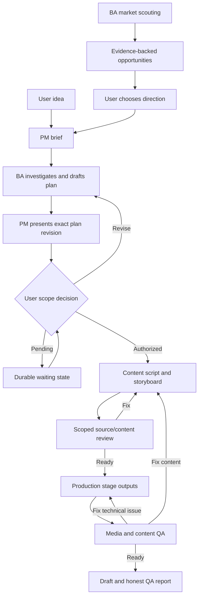

# Workflow and next increments

A response can choose an idea and approve a concrete plan together when scope is already clear. Routine repairs inside standing authorization do not need another approval conversation. Major scope changes return to PM/user. These are roles, not mandatory separate agents.

Next after v0: select a real pilot, observe information loss and unnecessary work, improve targeted references/helpers, try P-2 in another niche, then verify channel/account/publishing capabilities and recovery. Public YouTube channel methods do not provide a channel-creation call: do not promise a nonexistent API. Analytics requires suitable account authorization. Any scheduler still needs working tools, fresh data and an online supported execution environment.

Token optimization is evaluated with comparable tasks/model/settings/source corpus and actual usage if exposed, not by prompt length alone. Context and decisions are durable files; Git synchronization does not copy a live chat or its credentials to another computer.
