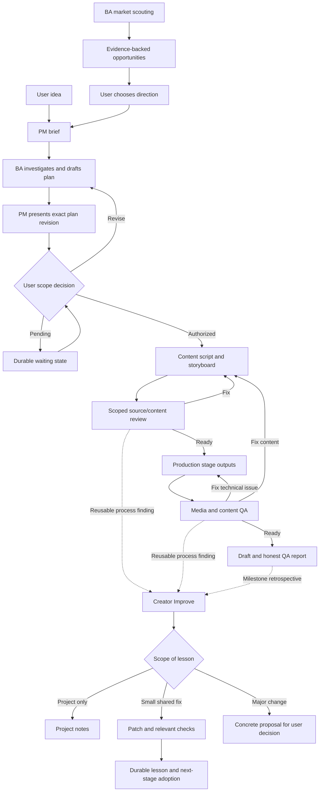

# Workflow and next increments

A response can choose an idea and approve a concrete plan together when scope is already clear. Routine repairs inside standing authorization do not need another approval conversation. Major scope changes return to PM/user. These are roles, not mandatory separate agents.

Next after v0: select a real pilot, observe information loss and unnecessary work, improve targeted references/helpers, try P-2 in another niche, then verify channel/account/publishing capabilities and recovery. Public YouTube channel methods do not provide a channel-creation call: do not promise a nonexistent API. Analytics requires suitable account authorization. Any scheduler still needs working tools, fresh data and an online supported execution environment.

Token optimization is evaluated with comparable tasks/model/settings/source corpus and actual usage if exposed, not by prompt length alone. Context and decisions are durable files; Git synchronization does not copy a live chat or its credentials to another computer.

## Continuous improvement

All roles can surface an evidenced finding; PM routes it to [creator-improve](../.agents/skills/creator-improve/SKILL.md) without creating another agent by default. During execution, apply useful small reversible kit fixes within standing scope and then resume the original task. At project milestones/close, consolidate relevant findings and unresolved proposals. These events do not require a change when no reusable lesson exists.

Project-only preferences stay in the project. Shared lessons live in improvements/ with provenance, actual checks, adoption timing and undo guidance. A new rule is not a substitute for fixing a simpler ambiguity. Load lessons selectively and preserve in-flight plans, user authority and unrelated writers' files. This feedback loop is instruction-driven, not an implemented background service, hot reload or analytics adapter.
